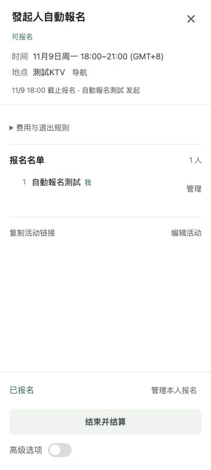

# 發起者自動報名 · 20261108-10

移除發起表單（含高級選項）中的「本人參加」勾選，發布新活動或複製活動時自動為發起者報名。後端建立活動省略 join_owner 也默認 true；明確 false 僅保留舊 API 客戶端相容。舊本機草稿的勾選值不會再影響網頁提交。

保存草稿仍不占名額，發布時一律為發起者報名，包括先前選擇不參加的舊草稿。發起者算一個正式名額、默認一份 AA，透過既有報名接口保留同意、排隊及活動紀錄；建立與報名在同一交易中提交。報名截止已過會要求修改期限，不發布一個缺少發起者報名的活動。

只在新活動／草稿發布時自動報名。編輯已發布活動不會補報或重複報名，也不回填歷史活動；發起者發布後可照既有規則自行退出。無資料庫遷移，既有名單、費用、收付款、圖片與歷史保持不變；1Panel／代理／TLS 不改動，QQ 接入仍待審核。

## 驗證

- 163 項後端測試通過，新增省略參數自動報名、唯一名額與候補、請求重放不重複、舊草稿發布、重複發布、退出後編輯不補報及過期草稿拒絕發布等場景。原排隊測試明確以舊 API 的 join_owner=false 建立不含組織者的測試樣本，保持原測試意義。
- JavaScript 語法及既有日期、結算 payload、客戶端重試、角色待辦測試通過。
- 360px 本地隔離環境確認高級選項也不含本人參加勾選；直接發布後顯示發起者為第一位參加者、「已報名」，瀏覽器未見錯誤。正式站只進行唯讀驗證。

## 部署結果

已發布至 https://kanban.danndann.cn/，版本 20261108-10。server2 的隔離測試同樣 163 項通過；正式資料隔離副本遷移演練通過。HTTPS 首頁與 10 個帶版本資產逐位元一致，後端 events.py 雜湊一致，健康檢查與匿名列表正常。

發布前後所有資料表的原始列與值完全一致，完整性與外鍵檢查通過，遷移仍為 1–5。恢復包、原始資料庫、升級腳本及伺服器測試記錄保存在 `/var/backups/qgroup-upgrade-20261108-10/`；發布後備份 `/var/backups/qgroup/kanban-20261108-055856.sqlite3`。

