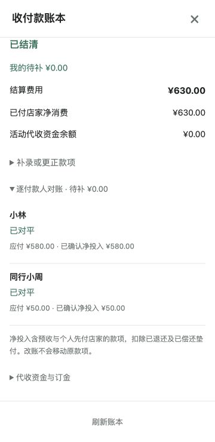

# P4 收付款帳本發布紀錄

版本 20261108-6，於 2026-11-08 09:43（Asia/Taipei）完成部署與核對，沿用 server2、127.0.0.1:8791 及既有 1Panel 網站。

- 預收、付款申報與發起者確認，支援分次、多付、代付及獨立的實際轉款人。
- 逐付款人待補／應退、個人墊付及償還、代收資金及實際移交。
- 可退訂金／押金、部分退回與抵消費／轉損失，店家退差價另記資金流。
- 款項、申報與決定均追加保存；錯記沖銷，原文及關聯持續可查。改帳不移動已收款。
- 結清檢查點、改帳後重新待處理、歸檔及轉交後繼續對帳。
- 手機先預覽後確認、輸入變更使預覽失效、衝突保留輸入、雙重歷史翻頁。

契約及會計恆等式見 [收付款契約](../finance-contract.md)。

## 驗收

- 本機 Python 3.9、伺服器 Python 3.11 共 135 項後端測試通過，原 95 項保留；另 10 項時區／跨日及 11 項結算表單斷言通過，六份 JavaScript 語法及 Python 編譯檢查通過。
- 涵蓋預收後改帳、部分／多付退款、實際代轉與責任分開、個人墊付／墊退、訂金退回／抵扣、取消部分損失、店家退差價、款項移交、舊付款人保留、非報名付款人沿用同一 ID、拒絕／撤回／重複確認、退款重試、關聯沖銷、權限、申報私密性、完整翻頁、併發及事務回滾。
- 360px 瀏覽器驗收走完申報、確認、同行多付 20 元退款、100 元訂金抵消費、530 元店家尾款及 630 元結清。修改後重新預覽、409 保留輸入、載入最新版、代付及個人墊退均驗證；無橫向溢出或 JavaScript 錯誤。另檢查桌面對話框。真實 QQ WebView 與軟鍵盤集中於 P5 驗收。
- 圖片為本機隔離測試資料；正式庫未新增測試帳號、活動、申報或款項。

## 正式遷移與保全

- 發布前線上備份：`/var/backups/qgroup/kanban-20261108-013927.sqlite3`。先用隔離副本連續遷移兩次，再以停機最終快照重新演練；正式遷移由原 DynamicUser 服務啟動執行。
- 上線後核對快照：`/var/backups/qgroup/kanban-20261108-014256.sqlite3`。所有原表、原列及原值比較通過：17 帳號／17 瀏覽器會話、3 活動、11 位參加者、8 條舊報名、1 舊帳及其版本、圖片和其他表均完整保留。
- 遷移版本為 1、2、3、4；三張新增帳本表為空，未虛構已付款。SQLite 完整性與外鍵檢查通過。
- HTTPS 健康為協議 2，首頁七個靜態引用為 20261108-6，全部 JavaScript／CSS 逐字節核對。匿名帳本僅可讀，無財務管理／申報權限；原人均帳單金額、除數、備註及歷史可讀，原模式保留。公開回應未含內部身分或瀏覽器令牌。
- root 專用恢復目錄：`/var/backups/qgroup-upgrade-20261108-6/`，保留升級前程式、停機原資料庫檔案組、合併 WAL 後的 `database-before.sqlite3`、發布包與測試日誌。原 1Panel、代理、TLS、systemd 及每日保留 14 份備份設定沿用。
- 上線後若已有真實新款項，先另行保全並對帳，不直接以舊庫覆蓋。暫存部署及演練資料已清理。

此階段只登記款項，不執行真實支付。P5 接續使用體驗、草稿與日常功能；QQ OAuth 等待官方審核。
