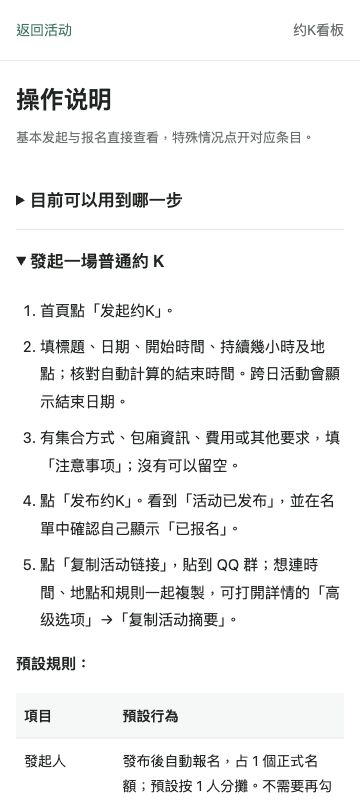

# 頁尾操作說明 · 20261108-11

首頁底部新增「操作说明」，連到 `/guide.html`。活動列表很短時入口保持在頁面底部，長名單則位於內容後方。說明頁提供返回活動入口，基本發起及本人報名預設展開，其他主題與特殊流程以原生 details／summary 收合，手機可直接點選。

內容由 `docs/user-guide.md` 生成，完整保留 10 個主題、26 個子題，包括同行／代報、整組候補、待確認、逾期退出、補報邀請、認領、改期、協辦／轉交、現場補錄、分攤與帳單更正、收退款、換裝置及異常處理。公開頁不含維護者用的本地文件連結或發布版本編號。

更新手冊後執行 `python3 deploy/build_guide.py`；僅構建時需要 markdown-it-py。線上頁面為靜態 HTML，不載入 JavaScript 或第三方服務，不建立登入身分、不讀寫活動資料。後端只增加明確允許的 `/guide.html` HTML 路徑，未放寬為任意檔案存取。

## 驗證

- 163 項後端測試通過。
- 首頁與說明頁 GET／HEAD 正常、HTML MIME 正確，靜態請求不設 Cookie；生成內容的章節及子題數與來源一致。
- 360px CSS 視口實際點擊頁尾入口，展開特殊報名及整組候補說明，再返回活動；文件與視口寬度均為 360，未橫向溢出。
- 保持既有報名、分攤與權限。無資料庫遷移，不改 1Panel／OpenResty／TLS。正式活動不寫測試資料。

## 部署結果

已部署至 https://kanban.danndann.cn/，說明頁 https://kanban.danndann.cn/guide.html。HTTPS 首頁、10 個帶版本資產與說明頁均與發布檔案逐位元一致；說明頁 GET／HEAD 正常且不設 Cookie，健康檢查正常。

正式庫隔離副本遷移演練通過，發布前後所有原資料表及欄位值完全一致，完整性與外鍵檢查正常。恢復資料與發布包保存在 `/var/backups/qgroup-upgrade-20261108-11/`；發布後備份 `/var/backups/qgroup/kanban-20261108-062437.sqlite3`。
