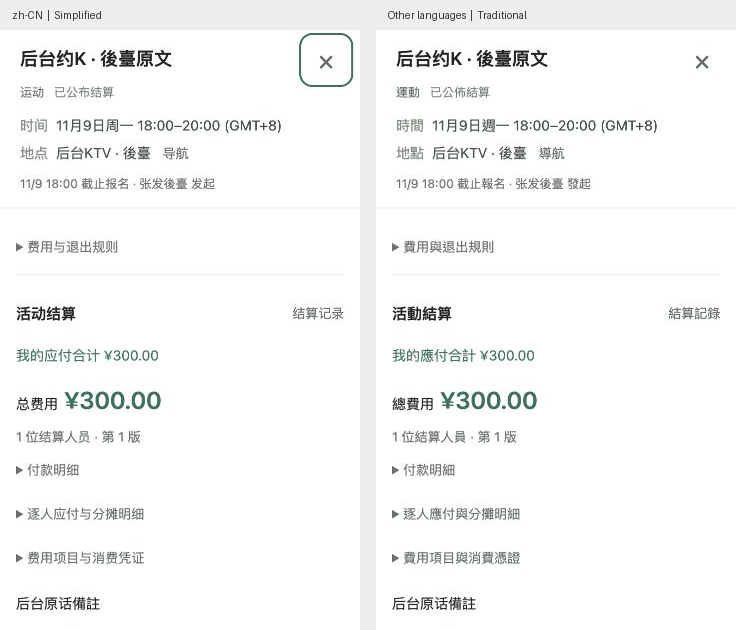

# 简繁适配 · 20261108-12

首页、活动、报名、同行、候补、安排、账号、通知、结算、收付款、历史与操作说明按浏览器首选语言自动显示。首选简体中文（zh-CN、zh-SG、zh-Hans）使用简中；其他语言及无语言标头使用繁中。字段的原生必填／格式提示也使用当前页面语言。

静态 HTML／JS 在构建时生成两套，后端对已知系统消息的固定片段适配；插值、人名、活动内容、地点、备注、原因、费用项目与历史原文维持原样。日期显示采用页面语言，活动时区不变。分类和状态保留原协议值，只转换显示标签。模糊的历史自由文本保留原文，避免误改参与者文字。不新增账号、语言开关、数据库迁移或生产运行依赖。

构建：`npm ci --ignore-scripts`、`python3 deploy/build_guide.py`、`npm run build:locales`。前者使用锁定的 Babel parser 与 OpenCC，Python 手册构建需要 markdown-it-py；线上只部署生成产物。新增动态消息必须明确固定片段与用户变量边界。

验证：172 项后端测试通过；Node 验证两套实际发布脚本的分类协议、活动历史、原生提示、结算原文及跨日时区，并通过既有客户端恢复、结算表单与待办测试。所有 30 个源／生成 JS 文件语法通过。隔离数据库和 360px 浏览器验证英文默认繁中、简中、繁中手册、发起自动报名、切换分类、结算预览和发布，混合简繁的称呼、标题、地点和备注维持原样。正式站点仅作只读验收。

发布前执行在线备份、停服快照和隔离迁移演练，保留现有所有活动、图片及审计资料；升级仅应用文件，1Panel、反向代理及 TLS 配置不变。

## 部署结果

已部署至 https://kanban.danndann.cn/ 。51 组 HTTPS 语言／资源组合与本地发布文件逐位元一致，Content-Language 正确，Vary 包含 Accept-Language；健康及活动列表正常。正式验收未建立账号或写入活动。

首次部署发现新目录受备份用 umask 影响而不可读，已修正语言目录的 755 权限，并在发布脚本补上应用目录权限及两种语言页面／帮助／脚本的启动检查。

发布前后全部原有表、列及值一致，保留 18 位用户、4 场活动、12 位名单人员及现有账单、图片与审计记录；完整性、外键及迁移 1–5 正常。恢复资料与验收记录：`/var/backups/qgroup-upgrade-20261108-12/`；发布后备份：`/var/backups/qgroup/kanban-20261108-065431.sqlite3`。

