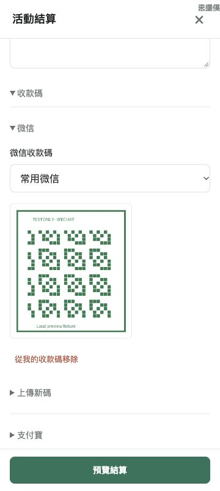

# 可重用收款码与独立图片存储 · 20261108-13

结算「收款码」内分微信、支付宝、其他，每类最多一张，可同时提供三类。上传时可命名，完成后保存到当前账号的私人码库；下一场活动可直接选用。旧账单单张码先归其他，可显式保存到自己的码库。每账号最多 30 张有效码，可软移除，不改已发布的图片。

新收款码和消费凭证按文件 SHA-256 存在数据库旁的私有 images/，SQLite 只存元数据及版本引用，相同文件跨活动、用途及账号只保存一份。旧 BLOB 保留原样读取，不改写旧账单和审计历史。迁移 6 只新增资源、私人码库及不可变结算图片引用表。类型、名称、图片及移除均参与结算预览、版本与差异记录。

私人码库按既有账号隔离，跨设备须连接同一账号。转交活动不会开放前任的私人库，当前账单可以明确保留已发布的原图。图片仍经活动权限读取，不开放图片目录或凭摘要读图。每图 2 MiB，每版所有收款码和消费凭证合计 6 MiB；图片编码、校验及既有 PNG 规则不变。

每日备份改为同一数据库快照及其引用的图片包配对：`.sqlite3` 与 `.images.tar.gz`，配对成功后才出现最终数据库文件，保留最近 14 对。verify_migration.py 会从原目录或配对包复制并验证图片，恢复需要同时还原两者。文件先持久化再提交 SQL；失败事务可能留下不可访问、无数据库引用的文件，备份不会收录。

验证：183 项后端测试通过，包含私人权限、跨账号和跨活动去重、三类并存、预览只读、移除与替换、类型／名称更改、无变更判断、活动交接、旧 BLOB、失败回滚及数据库／图片完整恢复。Node 现有时区、结算表单、恢复、待办及两套实际语言脚本测试通过；33 个源及生成 JS 文件语法通过。

360px 本机浏览器实测微信／支付宝上传、预览和发布，第二场活动直接选用上次上传的码。简繁系统文本与用户名称原文保持既有规则。未在正式活动写入测试资料，不改 1Panel、反向代理、TLS 或系统服务配置。

## 部署结果

已部署至 https://kanban.danndann.cn/ 。53 组 HTTPS 语言／资源组合与发布文件逐位元一致，私人码库匿名访问返回 401 且不建立账号。原有所有表、列和值完全保留，迁移 1–6、完整性及外键正常。

恢复资料、发布包和验收记录位于 `/var/backups/qgroup-upgrade-20261108-13/`；发布后配对备份 `/var/backups/qgroup/kanban-20261108-082553-380646.sqlite3` 与同名前缀 `.images.tar.gz`。正式备份已在隔离副本恢复并验证；当前正式库尚无新版外部图片，实际图片的配对恢复由隔离测试覆盖。
