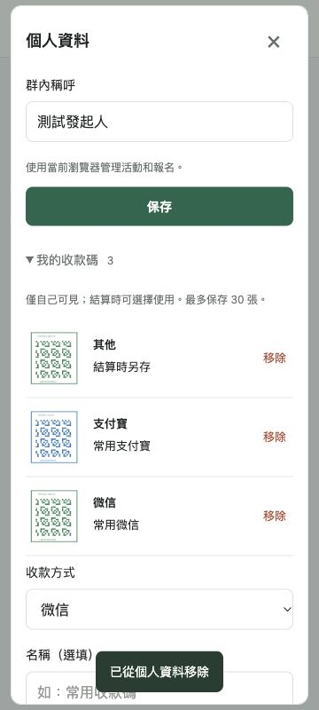
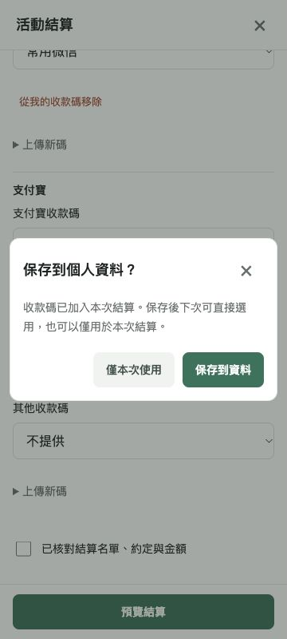

# 個人資料收款碼與選擇保存 · 20261108-15

右上角稱呼開啟「個人資料」，所有帳號可在「我的收款碼」提前保存微信、支付寶、其他收款碼；每張可命名、查看原圖及移除，沿用每帳號最多 30 張的私人碼庫。無須先發起活動。

結算上傳新碼先加入本次表單，再提示「保存到資料」或「僅本次使用」。後者不建立私人碼庫記錄，仍可預覽及發布，也可稍後按「保存到個人資料」。保存失敗保留本次選擇，過期表單的確認不能存入新表單。既有帳單碼亦可保存到個人資料，原名稱保留。單次上傳名稱經後端長度驗證並凍結在結算版本；保存或移除私人碼庫不改舊結算。

沿用現有私人碼庫 API、檔案去重和圖片存取權限，無資料結構遷移，不改 1Panel、代理、TLS 或系統服務設定。個人資料與結算圖片仍按原來的帳號及活動權限分別存取。操作說明與簡繁介面同步更新。

驗證：186 項後端測試通過；新增任意帳號提前存碼、具名稱的單次結算碼不自動進碼庫、事後另存及移除不改已發布版本、名稱驗證失敗無部分寫入。Hans/Hant 實際腳本測試確認不自動保存、暫存還原、保存失敗後重試與過期提示隔離；原有 Node 表單、日期、恢復、待辦測試及 33 份 JS 語法檢查通過。

360px 本機瀏覽器走完個人資料上傳、結算選用、拒絕保存後發布、同意保存後在個人資料出現及移除流程；無橫向溢出，所有測試圖片及資料僅寫入隔離本機資料庫。

已部署至 https://kanban.danndann.cn/ 。53 組 HTTPS 語言／資源組合與發布檔一致，簡繁匿名私人碼庫均回應 401 且不建立帳號。原有所有資料表、列和值完整保留，遷移仍為 1–6；完整性、外鍵及資料庫／圖片配對備份的隔離恢復驗證通過。恢復及驗收記錄：`/var/backups/qgroup-upgrade-20261108-15/`。
