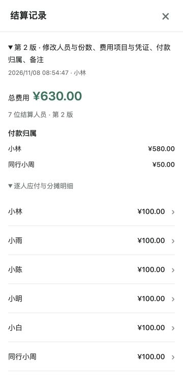

# P3 逐人结算发布记录

版本 20261108-5，沿用 server2 应用、8791 端口与 1Panel 设置。已于 2026-11-08 09:08（Asia/Taipei）部署并完成上线核对。

## 交付

- 费用明细与消费凭证；共同／指定范围，正常 AA、半份、免共同费用、单独消费、比例、固定金额及参与分钟。
- 结算前逐人核对名册、缺席／退出及最后接受的费用约定，例外须原因。
- 付款人独立建模，代报统一承担及多人合付，付款人合计精确对平。
- 整数分／有理数与最大余数法，固定且可解释的补分顺序，无未分配尾差。
- 原人均账单通过明确核对转为新版本；历史冻结称呼、分配、付款归属、备注、收款码与消费凭证，展示版本差异。
- 预览后发布、输入变更重新预览、冲突保留输入、请求重试去重，全部业务及记录在同一事务提交。

95 项后端测试、10 项时区／跨日断言及 11 项结算表单断言通过。覆盖七位一位免 A 的 600 元例子、免 A 者个人消费、固定／比例／时长、店家退差价、零元、多人合付、图片与旧账保全、权限、同名、交接、竞态、事务失败及迁移回滚。

手机验收在 360px 宽度覆盖逐人账单、免 A、个人消费、合付、凭证、编辑后重新预览、409 保留输入、指定人员分钟／比例默认值、差异历史及旧账转换。无横向溢出、无 JavaScript 错误。验收图为本机隔离资料，未向正式活动写入测试数据。

## 正式部署与保全

- 正式备份及停机最终快照均在隔离副本连续迁移两次，服务器 Python 3.11 上 95 项测试通过。正式迁移由原 DynamicUser 服务启动执行，未修改 1Panel、代理、TLS 或 systemd 设置。
- 上线前后所有表的原列、原值比较通过：17 个账号、17 个浏览器会话、3 个活动、11 位参加者、8 条旧报名、1 个旧账与其历史及图片完整保留。迁移只追加版本 3 和两个空的新表，SQLite 完整性与外键检查通过。
- HTTPS 健康检查为协议 2，首页六个静态引用均为 20261108-5，全部 JavaScript／CSS 与部署文件逐字节一致；公开响应无身份令牌。
- 发布前在线备份：`/var/backups/qgroup/kanban-20261108-010613.sqlite3`；上线后核对快照：`/var/backups/qgroup/kanban-20261108-010816.sqlite3`。日常保留策略仍为 14 份。
- root 专用恢复目录：`/var/backups/qgroup-upgrade-20261108-5/`，保存 `code-before.tar.gz`、合并停机 WAL 后的 `database-before.sqlite3`、原停机文件组、发布包及测试日志。发布后若有新增业务数据，先保全并对账，不直接以旧库覆盖。

## 后续范围

本阶段生成应付责任，不登记实际转账／实收。P4 接续预收、垫付、申报、实收确认、冲销、补款与退款。QQ OAuth 仍等官方审核。
