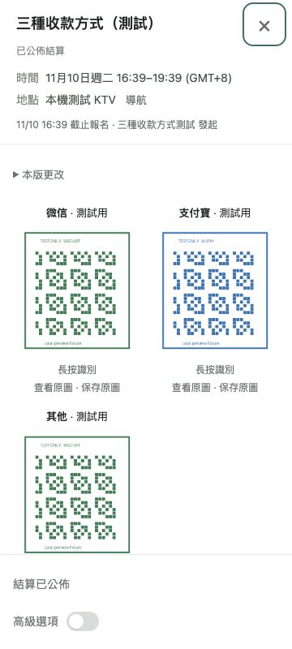

# 收款碼同時顯示 · 20261108-14

結算編輯頁直接顯示所有已選的微信、支付寶、其他收款碼；選碼及上傳集中於「選擇／上傳收款碼」。預覽、已發布帳單及歷史記錄使用同一圖片排列，手機兩欄並排、第三張換行，較寬畫面三欄顯示。每張仍可查看及保存原圖。

不改後端、資料結構、私人碼庫權限或結算版本規則。操作說明及簡繁介面同步更新。

驗證：兩套實際語言腳本測試三張圖片全部顯示、編輯表單在收合控制外顯示圖片、三類選碼保留。現有 Node 表單、日期、恢復及待辦測試通過；33 份來源及生成 JS 語法通過。360px 本機瀏覽器驗證編輯、預覽及已發布帳單兩張並排、三張換行，圖片全部載入，頁面無橫向溢出。

已部署至 https://kanban.danndann.cn/ 。53 組 HTTPS 語言／資源組合與本機發布檔一致；所有既有資料表的原始值完整保留，完整性、外鍵及配對備份隔離恢復驗證通過。恢復與驗收資料：`/var/backups/qgroup-upgrade-20261108-14/`。未更動 1Panel、代理、TLS 或系統服務設定。
