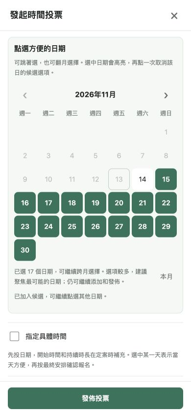

# 月曆選日、取消候選數量上限與 bot 縮寫查詢

2026-11-13 17:27（Asia/Taipei）完成 server2 切換。發布範圍：`both`。前端、API 與草稿取消投票 6 項限制，bot 將候選改為摘要通知；同時發布縮寫查詢功能。資料庫維持 schema 18，請求欄位、outbox 格式及通知設定語意不變。

## 使用行為

- 月曆可跨月點選不連續日期，再次點擊取消；「＋」按需添加，至少 2 項，沒有固定候選數量上限。超過 14 項只顯示縮小範圍建議，不阻擋添加或發布。
- 日期／精確時間模式切換、草稿保存與恢復保留全部候選及原時間。日期投票仍在定案時補充具體安排，投票不占報名名額。
- QQ 發起通知提供候選數量和日期摘要，超過 5 個不同日期時顯示首末日期並註明可以不連續；完整候選透過投票頁查看。精確模式另附共同時長，日期模式明示具體時間待定。既有不可變 outbox 本文不改寫，worker 發送前重新組裝摘要。
- @ bot 輸入 `/缩写 yyds`、`/縮寫 yyds` 或 `/nbnhhsh yyds,nbnhhsh`，查詢第三方公開 API；只傳正規化縮寫，結果供參考。沿用原群組授權與回覆政策，背景查詢不持有 SQLite 連線；詳見[縮寫查詢](../bot-abbreviations.md)。

## 版本與來源

正式來源 `675984b34cef4255b0eee1f16d10e82486399c07` 已整合並推送 main，乾淨工作目錄執行完整 SHA 來源檢查通過後才封存。Archive SHA-256 `7356e86a76a41f9cc933acaf7fbe064181c3f7e534c0348bf3535de8bd3d3060`。乾淨建置目錄 `/opt/qgroup-releases/flex-675984b`，只建置一次。

| 階段 | 服務 | 完整來源 commit | 映像引用 | 實際 image ID |
| --- | --- | --- | --- | --- |
| 切換前 | web、bot | `779a483e0a0ad80ba61127ed58a21230abc04c5f` | `qgroup:20261113-dates1-779a483` | `sha256:1c30a843e0343913434ab344cd3b5f064af97779aa076379338593b4f486e4ee` |
| 切換後 | web、bot | `675984b34cef4255b0eee1f16d10e82486399c07` | `qgroup:20261113-flex1-675984b` | `sha256:1b41f6a4e21b37dbfec46e80fa23d40e5f98136deac395da50a57e9ac11ae0c8` |

## 驗證與相容性

- 本機合併後完整 Python 575 項通過，前端 13 組通過；補入縮寫用法並重建手冊／簡繁產物後，語系與投票前端檢查再次通過。
- 日期／精確模式各 40 項投票完成建立、改票、選最後一項定案及僅發起者自動報名核對；各 60 項的排隊與模擬通知保留數量、摘要及連結，文字少於 800 字。
- 正式映像在 bot 關閉／啟用兩種設定下，均以 UID:GID 994:992、唯讀根目錄、無網路、無正式憑證執行完整 Python 575 項通過（各 skipped=8）。縮寫上游與 QQ 投遞的自動測試使用模擬。
- SQLite＋圖片配對備份的隔離副本完成兩次初始化，schema 18 → 18，原表原有欄位每個值與圖片摘要保留，完整性及外鍵檢查通過。
- 分別使用發布前兩服務的實際映像，在尚無超過 6 項投票的隔離副本驗證：初始化不改資料、所有未刪除投票序列化與通知組裝、活動指令及設定仍可用。此結果只支持新流量開放前的回退；新版 web 搭配舊 worker 可能產生過長通知，因此成套切換。
- 本機 390×844 手機操作 17 個跨月且不連續的候選日期，超過 6 項仍能繼續添加／發布；切換模式、保存／恢復草稿後，17 項與原 19:30 時間完整保留，瀏覽器無錯誤。未對正式投票或活動做驗收寫入。

## 正式驗收與保全

- 切換順序：停止 bot → 停止 web → 非 root 初始化 → 核對原資料 → 啟動 web → 啟動 bot。原表原欄位及所有值摘要一致，schema 維持 18，未還原舊資料庫。
- 兩服務均 healthy、restart 0，實際來源及映像符合表列值，各 100 個運行檔摘要符合來源。Bot 新 READY／ACK／poll 均晚於啟動，reconnect 0，啟動錯誤數 0。
- 外網簡繁首頁、app.js、手冊、i18n.js、time-polls.js、client.js 共 12 項均 200 且摘要符合來源；style.css 與 `/api/health` 正常。既有待確認結束活動的列表排除仍通過。
- Bot 設定 revision 6、worker 已載入 revision 6，time_poll_published 與實際發送政策保留，未修改通知目標、類型或模擬設定。
- 正式容器獨立行程驗證縮寫別名、help 與無參數用法；首次公開 API probe 未通過，隨後實際 client 查詢 `yyds,nbnhhsh` 與完整 probe 均成功。第三方可用性不能由這次成功保證。全程未向 QQ 發送測試消息，bot 連線、模擬投遞及 API 查詢均不等於真實群聊驗收。
- 演練配對備份 `/var/backups/qgroup/kanban-20261113-092500-158729.sqlite3`；切換前配對備份 `/var/backups/qgroup/kanban-20261113-092652-730305.sqlite3`，各有同名 `.images.tar.gz`。
- `/opt/qgroup-backups/flex-675984b`（0700）保存原來源、環境、manifest、版本基線、映像測試、備份演練、舊版相容性及切換／運行驗收記錄，舊映像保留。

## 回退限制

回退目標為表列發布前兩服務的保存映像。兩版 schema 相同，但舊 web 限制 6 項、舊 worker 逐項列候選，開始接受新寫入後優先向前修復。若須回退，先用當時資料副本驗證所有投票、待送工作與通知長度，處理超過 6 項的相容性，不得直接以舊備份覆蓋新資料。Compose 仍共用 QGROUP_TAG，回退前須再次核對兩服務實際映像與資料相容性。

本紀錄提交範圍 `none`，不重建、不重啟；正式運行來源維持表列功能 SHA。
