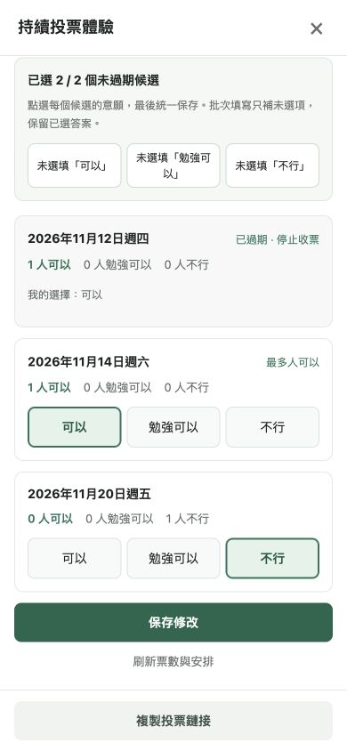

# 持續時間投票與直接點選介面

2026-11-13 19:57（Asia/Taipei）完成 server2 成套切換，隨後完成運行驗證。發布範圍：`both`。截止可晚於前面的候選，過期候選凍結票數，參與者改用直接點選與批次填寫；bot 發送前只摘要未過期候選。schema 維持 18。

## 行為

- 日期模式在所屬時區的日期過完後失效；精確模式在開始時間到達時失效。整場截止可晚於前面的候選，最晚須早於最後候選失效；日期模式表單最晚可設最後候選日 23:59。
- 過期選項停止新增／修改意願、保留原選擇與票數且不能定案。其他候選仍可投票或改票，最高票及定案理由只比較未過期選項。日期模式定案仍須指定未來的活動開始時間。
- 每個候選直接點「可以／勉強可以／不行」，選中狀態高亮，顯示已填進度。批次操作只補未選項，保留原答案，最後統一儲存。定期刷新過期狀態時保留未提交答案並停用過期選項。
- 日期／時間手動修改與草稿恢復後保留原值，表單依最後候選顯示截止上限與時區。既有投票截止不自動延長，發起者須在管理入口手動調整。
- 延遲 QQ 投遞會在發送前排除已過期候選；原不可變 outbox 本文不改寫。整場截止、提前截止、取消及定案仍停止收票。

## 版本與來源

正式來源 `8de72528e940a93f81b9b7f0117530b2913a64d1` 已整合並推送 main。乾淨工作目錄以完整 SHA 執行 `deploy/check_release_source.py` 通過後才封存。Archive SHA-256 `de65281ddb6bdd1ecbc7dc3da7653e7eae60a9cd73697348d4cc23653b76ad98`；只從此提交解包至乾淨目錄 `/opt/qgroup-releases/rolling-8de7252` 建置一次。

| 階段 | 服務 | 完整來源 commit | 映像引用 | 實際 image ID |
| --- | --- | --- | --- | --- |
| 切換前 | web | `675984b34cef4255b0eee1f16d10e82486399c07` | `qgroup:20261113-flex1-675984b` | `sha256:1b41f6a4e21b37dbfec46e80fa23d40e5f98136deac395da50a57e9ac11ae0c8` |
| 切換前 | bot | `09d61458046c58d3f88f4c07101db3efbf304cae` | `qgroup:20261113-sensitive-09d6145` | `sha256:9f92ca6442f2a15d843f1f7ed785806f5f3fd92aa1b1b6d754be1746e9d49001` |
| 切換後 | web、bot | `8de72528e940a93f81b9b7f0117530b2913a64d1` | `qgroup:20261113-rolling1-8de7252` | `sha256:b4d12cb2d50f7020a708cac1c083cc55775763bd4dad9738cd3ccf3b5f7854f4` |

## 測試與契約

- 本機完整 Python 623 項、前端 14 組通過；手冊、簡繁 bundle 與語系目錄均已重建。
- 正式映像在 bot 關閉／啟用兩種設定下，均以 UID:GID 994:992、唯讀根目錄、無網路、無正式憑證及隔離 SQLite 執行完整 Python 623 項通過（各 skipped=8）。
- 測試覆蓋跨早期候選的截止／延長、日期日末與 DST 界線、精確時間界線、過期意願凍結、部分選項提交、舊客戶端完整提交、未知／重複／缺漏選項拒絕、過期定案拒絕、最高票僅比較有效候選，以及延遲通知排除過期候選且不改 outbox 原本文。
- 390×844 手機本機操作逐項點選、批次補未選項與統一儲存成功，原答案及過期票數保留；未對正式資料做驗收寫入，也沒有向 QQ 群發送測試消息。
- Schema、outbox 格式及通知設定語意維持；API 新增 `options[].expired` 與 `options[].can_vote`，改票須完整提交未過期候選，舊客戶端完整提交中的過期部分忽略且不覆寫凍結選票。
- 配對備份副本完成兩次初始化，schema 18 → 18，原表原欄位值與圖片摘要保留，完整性與外鍵檢查通過。
- 分別以原 web、bot 實際映像讀取經演練的同一份隔離副本，初始化不改資料，活動指令、原投票序列化、通知組裝及設定讀取正常。這只支持新流量開放前的原版本組合回退；舊後端不會凍結過期選票，不能據此宣稱持續投票與舊版完整相容。

## 正式驗證與保全

- 切換順序為停止 bot → 停止 web → 非 root 初始化 → 核對原資料 → 啟動 web → 啟動 bot。所有原表原欄位及每個值摘要一致，schema 18 → 18，未還原資料庫。
- 兩服務 running／healthy、restart 0，實際 image ID 與來源符合表列值。各 110 個運行檔摘要符合發布來源。
- Bot READY／ACK／poll 均晚於新啟動時間，reconnect 0，啟動錯誤數 0。外網簡繁首頁、app.js、手冊、i18n.js、time-polls.js、client.js 共 12 項均 200 且摘要符合來源，style.css 與 `/api/health` 正常。
- 兩個正式容器各以唯讀 SQLite 連線讀取既有未刪除投票，確認過期／可投旗標、最高票排除與外鍵檢查正常；當時各核對 1 場投票、0 個過期選項。過期行為本身由隔離自動測試及本機示範驗證，未把正式只讀檢查宣稱為完整過期流程驗收。
- Bot 設定及 worker revision 均為 6，既有 time_poll_published 與實際發送政策保持；未改動群組或通知設定。原縮寫完整結果、敏感詞與續讀程式隨來源保留。
- 演練配對備份 `/var/backups/qgroup/kanban-20261113-115446-293948.sqlite3`；切換前備份 `/var/backups/qgroup/kanban-20261113-115709-174416.sqlite3`，各有同名 `.images.tar.gz`。
- `/opt/qgroup-backups/rolling-8de7252`（0700）保留原來源、Compose 環境、服務環境檔、manifest、兩服務實際基線、測試、演練、相容性及正式切換／運行報告。服務環境檔副本為 0600，不記錄其內容；舊映像保留。

## 回退限制

目標為表列原 web／bot 混合版本，以保存的明確 image ID 分別啟動。Compose 仍共用 QGROUP_TAG，不能整組跟隨移動標籤。舊 web 限制投票在最早候選前截止，舊後端仍允許修改過期意願，舊 bot 摘要包含過期候選；接受新流量後優先向前修復。若須回退，先停止服務並以當時資料副本驗證未定案投票與待送通知，處理新舊語意差異，再核對版本組合。不得以舊備份覆蓋發布後新寫入。

本紀錄與契約狀態更新範圍為 `none`，不重新建置或重啟；正式運行來源維持表列功能 SHA。
