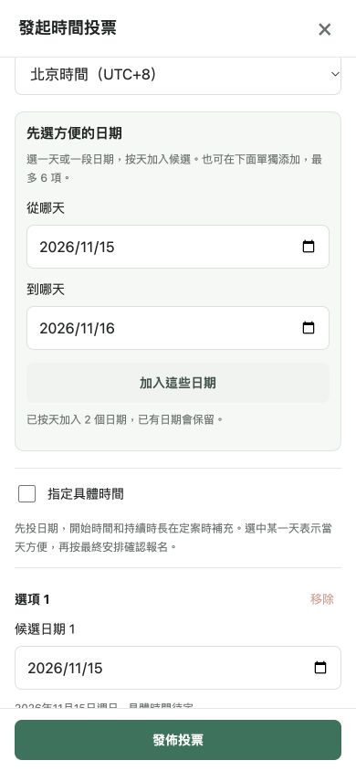

# 日期投票與按需添加選項

2026-11-13 16:48（Asia/Taipei）完成 server2 切換，16:49 完成運行驗收。發布範圍：`both`。新增日期投票語意與 schema 18，舊 bot 會把日期邊界當作精確時間，因此成套更新 web、bot。

## 行為

- 預設兩個候選日期，使用「＋ 添加选项」按需增加、移除，維持 2–6 項；日期段按天加入並去重，超上限時保留現有輸入。
- 預設只選日期；開啟「指定具体时间」後顯示各項開始時間及共同時長，切換保留內容。草稿保存動態選項、模式及時間，舊草稿依原精確時間恢復。
- 日期投票在定案時補開始時間及 1–24 小時的持續時長，開始時間必須在所選日期內，允許跨午夜結束。顯示真正活動目前安排；投票不占名額，定案仍只自動替發起者報名。
- QQ 日期通知明示日期及「具体时间待定」，不把午夜當作活動開始時間。發起通知預設開啟，沿用既有目標群與通知政策。

## 版本與來源

正式來源 `779a483e0a0ad80ba61127ed58a21230abc04c5f` 已整合推送 main，乾淨工作目錄的完整 SHA 來源檢查通過後封存。Archive SHA-256 `3c3aa5dbbcb676159f58db62a1a880e893969670cc9470bd4eecbaaf75e9dcc3`。乾淨建置目錄 `/opt/qgroup-releases/dates-779a483`，只建置一次。

| 階段 | 服務 | 完整來源 commit | 映像引用 | 實際 image ID |
| --- | --- | --- | --- | --- |
| 切換前 | web | `e82f33b60a0023b825da3d3862ba23b728637892` | `qgroup:20261113-removal1-e82f33b` | `sha256:99db853481af70375abeb8e10a12ad5ea259fc4e2fb8e260be53c2e284f233a9` |
| 切換前 | bot | `472db939b4a806e39de4a9aff6e9a56929a8c2f3` | `qgroup:20261113-polls1-472db93` | `sha256:a78e6fd567954ac81fe4726baa25becc277c927037e485470e23a135fdcb1047` |
| 切換後 | web、bot | `779a483e0a0ad80ba61127ed58a21230abc04c5f` | `qgroup:20261113-dates1-779a483` | `sha256:1c30a843e0343913434ab344cd3b5f064af97779aa076379338593b4f486e4ee` |

## 驗證與相容性

- 本機完整 Python 562 項及 Node 13 組通過，手冊與簡繁產物已重建。覆蓋日期序列化、投票、定案必要欄位、日期約束、過期票數版本、跨午夜、時區／DST、schema 18 失敗回滾與重試、既有精確時間投票及通知預覽相容性。
- 正式映像在 bot 關閉／啟用兩種設定下，均以 UID:GID 994:992、唯讀根目錄、無網路、無正式憑證執行完整 Python 562 項通過（各 skipped=8）。日期群通知測試使用模擬投遞。
- 正式 SQLite＋圖片配對備份的隔離副本完成兩次初始化，schema 17 → 18，原表原有列每個值與圖片摘要保留，完整性及外鍵檢查通過。schema 18 僅增加 time_mode，既有投票預設 exact；原候選、選票與 outbox 格式保持。
- 對發布前 web、bot 的兩個實際舊映像分別驗證：在遷移副本且尚無 date 寫入時，初始化不改資料，現有精確投票序列化、通知組裝及活動指令仍可用。此驗證只支持新流量開放前的回退，不代表舊版支援日期投票。
- 本機隔離資料以 390×844 手機尺寸操作日期段加入、「＋」添加、移除、精確時間切換、草稿保存／恢復、發布、投票、定案；正式活動正確建立為 19:30–23:30。沒有對正式投票或活動做驗收寫入，也沒有向正式 QQ 群發送測試消息。

## 正式驗收與保全

- 切換順序：停止 bot → 停止 web → 非 root 遷移 → 核對所有原資料摘要 → 啟動 web → 啟動 bot。原有資料一致，未還原舊資料庫。
- 兩服務均 healthy、restart 0，實際來源及映像符合表列值；各 99 個運行檔摘要符合新來源。Bot 新 READY／ACK／poll 均晚於啟動時間，reconnect 0，啟動錯誤數 0。
- 外網簡繁首頁、app.js、手冊、i18n.js、time-polls.js、client.js 共 12 項均 200 且摘要符合來源；style.css 摘要及 `/api/health` 正常。既有超時活動排除規則仍通過。
- Schema 為 18；bot 設定 revision 6、worker 已載入 revision 6，既有 time_poll_published 及實際發送政策保留，未修改目標群或其他通知設定。連線與模擬測試不代表真實 QQ 投遞驗收。
- 演練配對備份 `/var/backups/qgroup/kanban-20261113-084643-308403.sqlite3`；切換前配對備份 `/var/backups/qgroup/kanban-20261113-084838-473247.sqlite3`，各有同名 `.images.tar.gz`。
- `/opt/qgroup-backups/dates-779a483`（0700）保存原來源、環境、manifest、版本基線、映像測試、備份副本演練、舊版相容性及切換／運行驗收記錄；舊映像保留。

## 回退限制

回退目標為表列發布前 web／bot 的混合版本，必須分別使用保存映像；Compose 仍共用 QGROUP_TAG，不能直接整組跟隨移動標籤。新 date 投票與舊 bot 語意不相容，開始接受新寫入後優先向前修復。任何回退須先用當時資料副本驗證，處理日期投票及未送工作，不能直接啟動舊 bot，也不得以舊備份覆蓋新寫入。

本紀錄提交範圍 `none`，不重建、不重啟；正式運行來源維持表列功能 SHA。
