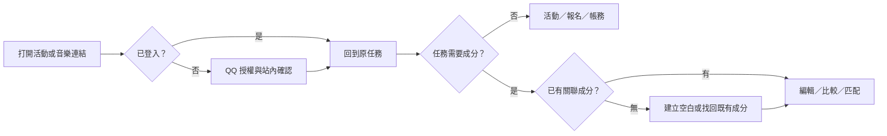

# 統一產品與操作流程

狀態：新產品規格；實作與驗收依[功能台帳](capability-status.json)及[整合需求台帳](integration-status.json)追蹤。發布範圍：`none`。既有能力以[功能矩陣](01-capability-inventory.md)為保留基線。

## 1. 產品中心

產品服務三個連續任務：找到一起玩的人、完成一場聚會、處理聚會前後的責任。音樂成分是認識同好與活動分組的資料，不是另一個需「進站」的產品；活動也不是音樂頁中嵌入的外站清單。

資料或登入缺少某個可選部分，只影響該部分。例如未建立成分可以報名、幫朋友報名和付款；沒有活動可以選成分、查排行、找搭子和自由分房。

## 2. 全站框架

介面遵守 [專案文案規範](../../AGENTS.md#介面文案與資訊密度)：頁面直接使用「活動」「音樂」「同好」「我的成分」等功能名稱，不加口號、裝飾性英文副標或重複介紹。純文案卡片與宣傳頁尾一併移除，不保留空白版位。保留有助操作的入口，以及狀態、限制、權限、錯誤與恢復等明確提示；不刪使用者內容、必要的法定資訊或可及性標籤。

桌面固定同一頁首：品牌、四個主入口、搜尋、通知／待辦、個人頭像。手機頁首只保留頁名及必要動作，底部四個主入口，內容頁保留清楚的返回位置。所有入口共用目前帳號、語言、主題、草稿及通知狀態。

| 主入口 | 預設內容 | 次層內容 | 主要動作 |
| --- | --- | --- | --- |
| 活動 | 可參與的活動、我參與的、待定時間 | 時間投票、往期、我的發起／協辦 | 發起活動、發起時間投票 |
| 音樂 | 搜尋與詞條列表，顯示已選及剩餘額度 | 熱門排行（列表／氣泡）、趨勢、最近新增、我建立的詞條 | 選成分、建立詞條 |
| 同好 | 我的推薦，解釋共同喜好與資料量 | 指定比較、找搭子／喊話、自由分房試算、圈子 | 查看成分、比較、發喊話 |
| 我的 | 本人活動摘要、我的成分摘要、款項待辦 | 成分編輯、帳號／裝置、收款碼、隱私、外觀 | 編輯成分、處理待辦 |

「動態」不再是另一個混合排行榜與喊話的頂層入口：音樂趨勢回音樂，找搭子回同好，帳號與活動通知回收件匣。能力全部保留，避免同一內容在多個頁面有不同操作。

全站搜尋按活動、詞條、同好分組，結果只包含目前有權看的資料；聯絡 QQ 查詢限登入會員，身份識別值不進一般搜尋。手機點搜尋後進專頁，避免擠壓導覽。全站搜尋屬整合後的新入口，既有拼音／假名／首字母搜尋能力必須保留。

## 3. 路由與頁面責任

下表為新路由規劃，不表示現在已存在。`personId` 使用公開 opaque ID，不使用 QQ 或 OpenID 作網址。

| 路由 | 頁面及責任 |
| --- | --- |
| `/`、`/activities` | 根路由導向活動；分類、時間、我的參與等條件可分享與返回 |
| `/activities/new`、`/activities/:id/edit` | 活動表單；本人草稿與伺服器草稿分清楚 |
| `/activities/:id` | 安排、本人狀態、名單、包間摘要、待辦與操作入口 |
| `/activities/:id/people` | 逐人名單、同行、候補、出席與認領；依權限顯示管理工具 |
| `/activities/:id/rooms` | 名單來源、音樂建議、人工調整、正式安排與版本 |
| `/activities/:id/settlement` | 現版帳單、本人應付／應退、歷史、收款碼與憑證 |
| `/activities/:id/settlement/edit` | 有權限者核對人員、責任、包間費用並預覽發布 |
| `/activities/:id/ledger` | 本人申報、實收付、各房與各持有人對帳、結清 |
| `/activities/:id/history` | 安排、報名、管理、結算與款項的可見操作紀錄 |
| `/polls/new`、`/polls/:id` | 日期／精確時段投票、管理、定案與正式活動銜接 |
| `/music`、`/music/entries/:id` | 詞條搜尋、分類、詳細與選取者名單；`/music` 為新音樂領域首頁 |
| `/music/rankings`、`/music/trends` | 列表／氣泡排行、熱度趨勢、漲幅與新增資訊 |
| `/people`、`/people/:personId`、`/people/compare` | 推薦、可見成分與指定比較；保留來源活動返回位置 |
| `/people/circles` | 現有聚類 API 的正式 UI 入口；此入口是補齊，不冒稱舊 UI 現在可達 |
| `/people/shouts`、`/people/shouts/history` | 找搭子、發布／冷卻狀態、過期喊話與分頁 |
| `/tools/room-lab` | 自選會員的自由分房；有活動上下文時可帶至該活動核對 |
| `/me`、`/me/music`、`/me/entries` | 個人摘要、唯一成分編輯器、本人自建詞條 |
| `/me/accounts`、`/me/devices`、`/me/payment-codes`、`/me/privacy` | 帳號／裝置與 QQ、私人收款碼、刪除申請 |
| `/inbox` | 未知結果操作、動態待辦、歷史通知；分區且各有狀態 |
| `/login`、`/auth/qq/callback`、`/auth/confirm` | 同一登入流程，保留原任務；回調不直接建立帳號 |
| `/access/:token`、`/invitations/:token`、`/claims/:token`、`/handoffs/:token` | 各種限權預覽與明確接受；不因打開連結直接執行 |
| `/admin/*` | 單一後台；帳號、活動支援、音樂、找搭子、資產、bot、隱私與資料保全 |
| `/me/devices/accept#token=…` | 十分鐘一次性裝置授權；fragment 暫存後移除，登入並明確接受，不自動切換 |
| `/guide`、`/privacy`、`/contact` | 同一框架下的手冊、政策和問題回報；簡繁與公開連結保留 |

活動詳情的次導覽是「概況、名單、分房、結算、紀錄」。帳本由結算區進入，管理工具依角色出現；不要把普通參加者先帶進所有財務表單。權限對應後端能力，不靠把按鈕藏起來保護資料。

## 4. 首頁與活動詳情

活動首頁優先呈現待開始／進行中活動及時間投票；我的待確認安排、候補遞補、申報核對與款項差額以單一待辦摘要提醒。往期與歸檔可搜尋，已超過預計結束但未實際結束的活動仍有清楚狀態，不默默變成已結束。

卡片只放標題、時間／時區、地點、名額、本人報名狀態及必要提示。完整費用和規則在詳情、提交前必定可見。首頁不堆上成分排行榜、喊話全文、圖表與帳本。

詳情頁順序：活動安排 → 我的報名與下一步 → 包間摘要 → 名單 → 結算摘要 → 詳細記錄。固定底部動作依目前狀態為「報名」「管理我的報名」「確認新安排」或「查看結算」，同一時間只有一個主要動作。

## 5. 身分與首次使用

- 公開活動仍可匿名查看；音樂會員資料仍須登入。匿名頁不顯示假的「只讀預覽」承諾，也不偷建正式帳號。
- 已有關聯者不再面對第二個「登入成分站」按鈕。登入會員但沒有成分時，音樂頁直接提供「開始選成分」和次要「找回既有成分」。建立前明確告知會新增成分與資料用途。
- 有舊資料者可在同一認領頁輸入舊 QQ＋PIN、再完成必要 QQ 授權。PIN 是取回舊成分的證據，永遠不作一般網站登入。
- 未關聯的舊成分不按同名或自填 QQ 自動認領。衝突顯示發生在哪個步驟與管理員處理入口，保留原草稿；取消或過期不建第二個帳號／成分。
- 同一帳號可保留不同的站內稱呼與成分稱呼；預設從帳號帶入，允許分開修改。統一頭像與個人卡承載這兩個稱呼，不能以重構名義覆蓋使用者資料。
- 帳號切換、裝置撤銷、QQ 衝突、缺 UnionID 引導和註銷限制完整保留。未取得 UnionID不阻擋現有網站功能，也不宣稱已可使用 bot 個人功能。

## 6. 成分編輯與同好

成分編輯共用一個工作區：上方搜尋與領域／細分切換，中間詞條，右側（手機底部可展開）已選清單。進度分開顯示領域 0/5、細分 0/15；領域與細分均可就地修改四級熟悉度。分類只列有資料的項目，搜尋支援名稱、拼音、首字母及現有假名規則。

點選產生同一份草稿，切到排行、詞條詳情或我的成分不會失去它；推薦依最後保存的成分計算，清楚顯示「保存後更新推薦」。保存列只有變更時出現，載明數量和錯誤；不整頁重載，不用成功提示掩蓋失敗。未建立成分可以是空白，保存選擇仍遵守既有至少 1 項及上限規則。

同好推薦提供「共同喜好／冷門優先」與「本命熟悉度優先」，顯示共同項、差異、資料不足區與分數含義。指定會員比較與推薦使用同一份可見性規則。成分卡在名單中用浮層快速看，完整個人頁用明確的「查看完整成分」進入；浮層不新增歷史、不疊彈窗、不讓代報人偏好冒充同行者。

私人留言保留與最相近者相關的限制，不因卡片共用變成公開自介。具體單向可見性差異先按[盤點問題](05-source-audit.md)補測與定義；UI 文案必須能準確描述後端授權。

## 7. 分房的完整閉環

1. 在活動詳情進「分房」，直接使用該場名冊，顯示正式／候補／待確認及有無成分；無成分與未認領同行仍在名冊，不能被演算法丟掉。
2. 檢視目前正式安排；發起者可生成新建議。一般會員可使用被允許的唯讀試算，但只有發起者可採用正式安排。
3. 設定房數、每房容量或自訂人數，選擇既有性別分組選項，得到共同詞條、平均／最差配對及孤立成員提示。無成分者留在「待人工安排」，也可人工安排進房。
4. 拖動或用可鍵盤操作的「移到某房」調整，重新算分；原名單狀態、付款歸屬不受影響。
5. 發起者點「採用為正式分房」才提交：檢查最新活動 revision、名冊、包間名稱／人員／付款人，預覽差異，確認後保存新版本。切換活動、名單已變或來源讀取失敗，舊建議失效並保留可查看的草稿，不得拿去另一場提交。
6. 正式安排可生成分享圖，活動頁和合作方 API 看同一版本。分享前顯示會包含的人名與資料，不包含私人留言、非公開性別或 QQ 身分。
7. 結算時從正式安排帶入，再核對實際房間、人員與費用。試算／正式分房／實際結算是三個明確狀態，不把建議當實際、不把指定付款人當已付。

這是新的整合能力；舊程式的成分試算目前不會寫回看板，不能把現況說成已有第 5 步。

## 8. 報名、投票與帳務

報名預設本人；帶朋友／只代報為同一表單的可選區域。逐人列出正式、候補、待確認與付款歸屬，混合結果或整組候補須明確接受。報名先預覽、再提交；規則變更須重看，不能按一次就接受後來的安排。

時間投票與活動在同一列表和發起入口，但保持兩種模型。選日期或精確時段 → 發布 → yes／maybe／no → 提前截止／繼續調整截止 → 定案 → 建立正式活動。投票不代報名，過期選項保留歷史且不可改票；定案後直接前往新活動完成本人或同行報名。

一般會員的結算頁先顯示「應付」「已確認投入」「待補／應退」與收款對象；申報另列待核對。結算權限者分別核對應付與實收付。訂金、墊付、代收、退款、沖銷及包間轉款在進階區，但不省略既有功能。帳單改版不改舊錢，認領與轉交不搬動責任。所有不可逆業務提交前都呈現確切的預覽差異與理由欄位。

## 9. 單一管理後台

| 分區 | 保留及合併方式 |
| --- | --- |
| 帳號與關聯 | 站內帳號、QQ 綁定狀態、成分關聯、人工 QQ 備註與管理角色在同一工作區；敏感值仍不回傳 |
| 活動支援 | 原本網站管理員的有限協助編輯；不自動成為活動發起者或結算人 |
| 音樂詞條 | 建立、編輯、刪除、合併，影響人數與選擇差異先預覽 |
| 會員成分 | 選擇與資料查看、PIN 重設、解除／修正關聯、成分刪除；帳號註銷另列 |
| 找搭子 | 喊話查詢與刪除，保留歷史及發布者可見性規則 |
| 外觀與資產 | 壁紙上傳、啟用、排序、輪播設定、刪除；會員自行停用與主題設定 |
| bot | 群允許清單、通知模板、發送模式、提醒、勿擾、Markdown、診斷、版本回報、回復前版 |
| 隱私與保全 | 註冊政策、同意版本、刪除待審、匯出／歷史備份及恢復狀態；完整恢復仍為受控維運 |

帳號管理、成分關聯和人工備註顯示在一起不表示三者具有相同認證效力。獨立管理憑證仍保留 bootstrap／救援用途，普通會員不需再登入另一個管理站。

## 10. 一致互動與可用性驗收

- 小任務就地完成；完整表單使用可直接連結的頁面。Popover 是輔助檢視，Dialog 只處理短確認；不再用多層彈窗承載整場活動。
- 手機主導覽、保存列與主動作列統一佈局管理，預留 safe area 和鍵盤高度；不能同時堆三層固定底欄。360、390、614、768、1280px 驗收無橫向溢出、遮擋或長名稱截斷。
- 返回保留列表位置、篩選與表單草稿。浮層關閉回原焦點；返回鍵不會誤提交或直接丟稿。路由替換與敏感 token 清理不破壞原邀請流程。
- 加載、空資料、未登入、權限不足、無成分、資料不足、來源故障、409 與結果未知各有獨立畫面。API 故障不能被顯示成「沒有活動／沒有群友」。
- 只對安全讀取自動更新；背景刷新不覆寫輸入、選票、分房或圖片。提交中鎖重複動作，逾時先查原結果。
- 表單有 label、錯誤關聯、鍵盤與讀屏操作；分房不依賴拖拽、排行不依賴氣泡、狀態不只靠顏色。尊重 reduced-motion。
- 保留簡繁策略及使用者原文，統一主題；不為外觀切換重建登入或清草稿。既有成分壁紙能力移到外觀設定。
- 同一登入帳號從活動名單開成分、查共同喜好、返回報名並繼續結算，不出現第二站的登入卡、頁首或返回外站連結。
