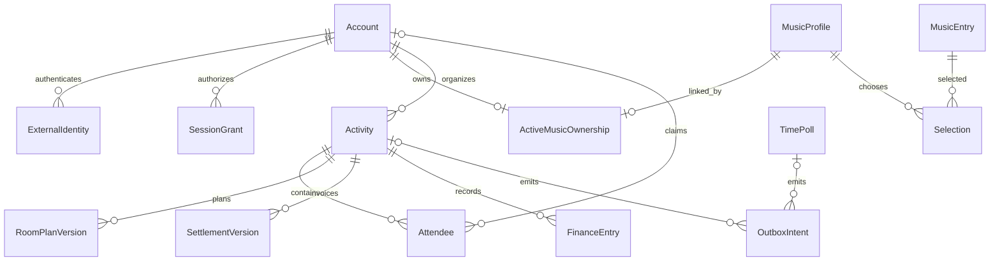

# 技術與資料架構

狀態：新系統的規劃基線；下列目錄與服務已有隔離實作，實際進度見[重構文件入口](README.md)。完整功能與版本組合尚未驗收，未發布新版。改共用 schema、outbox、bot 入口或語意時，先以 **`both`** 規劃，再依實證縮小範圍。

## 1. 架構決策

採 TypeScript 模組化單體：一個網站 API 是業務寫入入口，React app 是全部網站畫面的唯一來源，背景 worker 處理取樣、保全及 QQ 連線／投遞。模組按業務分界，不按「原看板／原成分」分界。

不引入微服務、Redis、第二套會員系統或分散式交易。沿用單機 SQLite 的部署規模，但網站運行不再依賴 Python 控制器或成分 JSON 全檔寫入。未來若需換資料庫，由 repository 層處理；這次不把資料庫選型擴張成獨立專案。

| 層 | 選擇 | 責任與限制 |
| --- | --- | --- |
| UI | React、TypeScript strict、TSX、Yahha UI | 所有動態與靜態產品畫面直接元件化；一致的 focus／表單／主題；不用 DOM 轉接 |
| 路由／建置 | React Router、Vite、npm workspaces | 真正頁面路由、按領域 lazy load、同一資產 manifest；沿用 npm 工具習慣 |
| 伺服器資料 | TanStack Query | 按帳號 scope、資源與版本分 key；切帳號清理受保護快取，不與表單草稿混用 |
| 表單／契約 | Zod、原生可及性表單＋領域 hooks | API runtime 驗證與 TS 型別同源；伺服器仍是驗證與權限權威 |
| HTTP | TypeScript、Fastify | session、Origin／CSRF、限流、舊 API adapter、OpenAPI、錯誤與追蹤 |
| 領域 | 純 TypeScript | 排隊、安排確認、音樂匹配、分房、精確分攤、金流及授權；不依賴 React、HTTP、QQ SDK |
| 資料庫 | SQLite WAL、better-sqlite3、顯式 SQL 遷移 | FK、唯一鍵、追加式觸發器、短交易；不在交易內請求外網或處理大圖 |
| 背景工作 | 獨立 TypeScript worker | QQ 官方 WebSocket／OpenAPI、outbox、重試、趨勢取樣與保全；按 claim 租約避免重複工作 |
| 驗證 | Vitest、Playwright、舊 Python 對照 runner | 契約、屬性／差分測試、隔離端到端及資料遷移演練 |

實作第一階段鎖定互相相容的實際版本與 Node LTS，提交 lockfile。上表是選型，並非聲稱這些依賴現在已安裝。Yahha 先延續現有元件體系，缺少的表單與佈局以共用封裝補足，不再混進舊站整套 CSS。

## 2. 新專案結構

```text
apps/
  web/src/
    app/                 # router、shell、providers、登入／錯誤邊界
    features/            # identity、activities、roster、polls、music、people、rooms、settlement、ledger、admin
  api/src/
    routes/              # /api/v2、新舊 URL adapters、公開 v1、OAuth、資產
    application/         # use cases、交易邊界、授權與命令去重
  worker/src/
    qq/                  # gateway、heartbeat、Resume、回呼、平台 API
    jobs/                # outbox、trend、backup、資料清理
packages/
  contracts/             # schemas、DTO、error codes、OpenAPI
  domain/                # 與框架無關的規則與演算法
  database/              # repositories、交易、migrations、legacy codecs
  ui/                    # TSX primitives、form patterns、tokens、圖表與主題
  content/               # 說明／政策內容、簡繁 system messages
  test-fixtures/         # 合成資料與去識別的規則案例，禁止正式資料
tools/
  migration/             # 匯入、對帳、刪除重播、切換驗證
  verification/          # 舊新差分、相容組合、來源與資產檢查
```

`apps/web` 不讀資料庫；`domain` 不 import app；bot 與 API 共用契約及規則，不能複製一套金額／可見性判斷。過渡期間的 Python 比對器與舊服務映像屬遷移工具，最終不進新網站 runtime。

## 3. 前端完成 TSX 化的界線

- 活動、名單、投票、分房、成分、圖表、帳單、帳本、全部後台、QQ 確認、手冊／隱私／聯絡內容用 TSX route component。公開頁可由同一組元件在伺服器產生初始 HTML／OG metadata，再 hydrate；不維護第二份 HTML 頁面模板。
- SVG 排行／趨勢使用 React 元件；Canvas 分享圖、下載與壁紙輪播用型別化繪圖服務和 hooks。瀏覽器 API 的必要 DOM ref 不等於舊 DOM 控制器。
- 不使用 `html-react-parser`、`react_controllers.mjs`、innerHTML 拼表單、全域函式操作 React 所屬節點、隱藏舊 DOM 或 iframe。必要可信靜態內容走明確的內容編譯流程，不以原站 HTML 當新元件。
- 「伺服器已保存資料」「未保存輸入」「未知結果的已送出操作」「純 UI 偏好」分開儲存，避免背景刷新改掉編輯內容。全站只有一份成分草稿，沒有舊控制器與 TSX 各持一份 selection。
- IndexedDB 保存本人 scope 下的活動／投票／成分／分房／帳單／款項草稿及必要圖片；localStorage 只放主題、低敏感偏好。session／PIN／OAuth token 不進其中。
- 所有可直接連結的頁面都有獨立錯誤邊界與權限狀態。發現 API 出錯不可降級為讀公開頁繞過登入。

## 4. 統一領域模型



此圖表達語意關係，不是已完成的 DDL。活動、成分和付款人的 ID 各自穩定，不能用同一個「人」表抹平差異。

| 領域 | 權威資料 | 保留規則 |
| --- | --- | --- |
| 帳號 | Account、ExternalIdentity、ExternalProfile、UnionIdentity、Session、SessionGrant | 外部識別採 provider＋client_id＋subject；UnionID 是對照資料，不自動併帳號 |
| 帳號管理 | AdminRole、RoleHistory、AdminCredentialSession、AccountMetadata | 人工 QQ／內部備註與真實外部綁定分開，原角色與稽核不丟失 |
| 成分身分 | MusicProfile、ActiveMusicOwnership、OwnershipHistory、LegacyClaimProof、ContactAlias | 成分 ID 不等於 QQ；同時僅一有效 ownership；解除後保留成分，衝突不猜配 |
| 成分內容 | MusicEntry、Selection、EntryCreator、MusicProfileFields | kind／category、選擇順序、細分程度、建立者、日期、留言、性別及公開旗標完整保存 |
| 活動 | Activity、ArrangementVersion、AttendeeConsent、ActivityAccess、EventRole、Handoff | lifecycle、報名開關、歸檔與結清獨立；協辦四種 scope、發起者及有限管理支援分清楚 |
| 名冊 | Party、Attendee、SignupInvitation、AttendeeClaim、PaymentOrigin | user_id 可空；管理人、參加者、付款人、出席各自獨立；同名不合併 |
| 投票 | TimePoll、PollOption、Ballot、Vote、PollHistory | 保留 date／exact、各候選過期時間、投票與定案版本；不代替活動報名 |
| 分房 | RoomSuggestion、RoomPlanVersion、RoomPlanMember | 建議含來源 revision 與演算法版本；正式計劃使用 attendee ID，未知成分者不消失 |
| 應付 | SettlementVersion、FrozenPerson、FeeItem、PayerAllocation、RoomInvoice、Receipt、CodeSnapshot | 舊人均版及新逐人版完整保留；凍結原姓名、責任、約定與金額，不重算歷史 |
| 實收付 | FinanceReport、ReportAction、FinanceEntry、Reversal、CloseCheckpoint | 追加式資料；保留舊付款 ID、關聯記錄、room_id、實際時間及資金恆等式 |
| 社群 | Shout、ShoutArchive、TrendSample | 140 字／24 小時／30 天等基線、歷史容量與取樣規則；不變成私人訊息系統 |
| 系統 | RequestResult、AuditEntry、Notification、OutboxIntent、DeliveryAttempt、BotConfigVersion | 去重、版本、角色重驗、已送本文、群規則、模擬／失敗與有限重試完整保存 |
| 保全 | Asset、ErasureIntent、PrivacyRequest、BackupManifest、MigrationMap | 持久刪除紀錄高於任何備份；恢復要驗證 DB、媒體及未完成工作一致 |

### 4.1 身分整合的底線

保留原 `users.id` 與 `attendees.id`，避免帳務、bot 短碼及外部 API 對照斷裂。成分的舊數字鍵與 `m_...` 鍵均記錄來源映射；新資料以 profile ID 存取，舊 API 用 adapter 翻譯。未認領的舊成分允許沒有 account；不為了 FK 製造假帳號。

現有 `links`、`prelinks`、`link_overrides` 的優先順序要先重播求出有效 ownership，再匯入歷史；禁止只讀 JSON 的 `boardUserId`。自填 `contactQQ`、管理員 `manual_qq`、舊數字會員鍵及 QQ OAuth 身分必須分欄。這些欄位的清空操作也有意義，不能用舊值補回。

### 4.2 權限與序列化

Account 只表示登入，Profile 只表示成分，Attendee 只表示一次參加；三者不是互相授權。授權在 application policy 層集中，DTO 採白名單：

- 公開活動／邀請活動的名單、歷史、資產沿用原存取範圍；個別受邀者未接受前只能看有限概況。
- owner、schedule、roster、attendance、settlement 各自判斷；指定結算人必須先接受，每場同時只保留一名指定結算人。settlement 不授予調整正式包間或轉交活動權。
- 站台管理員可以執行現有有限安排支援，不繞過邀請活動、草稿或財務授權。獨立管理憑證不等於會員帳號。
- 成分卡、推薦、比較、喊話、匯出及後台都用明確的 viewer policy；前端篩掉欄位不能代替後端。頭像和稱呼點擊不能洩漏同行代報人的成分。
- 一般 API 不回傳 OpenID、UnionID、session 摘要、PIN hash、內部備註或關聯金鑰；合作方 v1 只保留原白名單和金鑰語意。

## 5. 命令、交易與 API

新瀏覽器 API 以 `/api/v2` 分資源：session／account、activities、polls、music／entries、profiles、matches、rooms、settlements、ledger、notifications、admin。共用 contracts 產生 OpenAPI 與 client；公開合作方 `/api/public/v1` 獨立，不強迫外部同步改版。

**不是將舊 URL 改名就算後端重寫。** 每項 mutation 對應明確 use case，並在一個短 SQLite 交易內完成權限重驗、版本、業務、稽核、站內通知、命令結果與需要的 outbox 意圖。外部 QQ／網路失敗不能讓已完成報名變成不明的半筆交易。

命令 envelope 至少包含 `Idempotency-Key`、目前身份 scope、對應 `baseRevision`；帳單另有 `baseVersion`，投票管理有 `voteRevision`，財務／分房預覽另綁 ledger sequence 和來源版本。CSRF 與 session 授權分開；scope 是隔離識別，不是憑證。

| 情況 | 新系統要求 |
| --- | --- |
| 同帳號／同 key／同內容重送 | 返回原結果，重驗目前資源可見性與角色；不重複排隊、入帳或通知 |
| 同 key 換內容 | 409 `IDEMPOTENCY_CONFLICT`，保留輸入，不悄悄建第二份 |
| 版本或預覽失效 | 409 `REVISION_CONFLICT`／`PREVIEW_EXPIRED`，呈現差異並要求重新核對 |
| Cookie 與頁面 scope 不符 | 409 `IDENTITY_CHANGED`，不能把舊帳號草稿送給新帳號 |
| 逾時、5xx 或回應損毀 | 先查同身份的 request result，再讓使用者以原 payload／key 安全重試 |
| 權限撤銷或已轉交 | 立即生效，包括快取的命令結果、資產與待送消息 |
| 同一操作無實際變更 | 不增加無意義版本、稽核或通知 |

保留現有 outbox 的業務故障隔離行為：業務事實與應產生的意圖在交易中提交，非必要模板／群通知衍生失敗記錄診斷，不讓 QQ 可用性阻擋報名或帳務。不得將資料庫本身寫入失敗偽裝為通知非必要錯誤。精確對齊目前掛鉤例外邊界，再以測試鎖定。

### 5.1 舊協議與 URL

新 API adapter 覆蓋[程式索引](05-source-audit.md)中的有效舊入口，對應同一 use case，不保留第二套規則。已有明確截止的非 v2 舊寫接口維持既有截止（2026-12-09 00:00 UTC 起要求刷新），不因重構重新開放。

`/?event=...`、`?poll=...`、`invite`、`attendee_invite`、`management_invite`、`claim`、`account_link`、`action`、`qq=return` 需完整解析成新路由的任務上下文。`/music/#board|rest|mine|matches|room|event|shout|trend` 由相容入口在客戶端讀 hash 後轉換；HTTP 看不到 hash，不能只寫伺服器 301。

舊 `/music/` 無 hash 是成分首頁，新的 `/music` 是音樂領域首頁，切換時以規範化路徑和相容腳本一次處理；新 Router 必須消費舊 hash，避免重導迴圈。`/music/admin.html`、兩站 privacy、主站 html／無副檔名別名都要映射。QQ callback URL 保持相同，不能把 `code`／`state` 經一般 redirect、統計或日誌傳出去。

## 6. 必須精確重建的計算

### 金額與分攤

TypeScript 使用整數分及 BigInt 有理數做比例和最大餘數分攤。JSON 將超出安全整數範圍的值編碼為十進位字串；不直接序列化 BigInt，不以浮點乘除後四捨五入。當前金額上限及文字格式沿用，拒絕負數、非有限值與模糊格式。

正負項先按絕對值分配、再套符號；同餘依凍結報名順序，付款分攤同餘依凍結付款人順序。逐人、逐房、逐付款人均對平；不能因 JavaScript Map 或排序的不同改變補分。五種分攤、0／半 A、多人合付、費用減免、取消後損失與舊人均版全部有 golden fixtures。

實收付獨立於應付：全體淨投入＝店家淨消費＋未處理訂金＋代收資金；包間各自符合恆等式，不跨房淨抵。帳單、轉交、認領或改名不搬動舊錢。

### 匹配與分房

以 `music_site/upstream.py` 實際輸出建立 fixtures，包含領域／細分拆分、熟悉度、資料不足區、共同項量、冷門項、兩種排序、展示分上限、相近留言授權及無成分情況。現行 `match_stats` 的實際權重為 0.55／0.45，非舊 docstring 的 0.30／0.70。選取正規化、預設程度及既有領域程度資料先保留，不擅自「修公式」。

分房依同一演算法版本比對平均／最差／個人極值、共同項、孤立標記、容量及性別選項。隨機或同分結果先鎖 seed／排序，比較分組約束和分數，避免用不穩定房間排列當成失敗。改進公式是之後的產品變更，不夾帶在行為等價重寫。

### 時間

時間戳統一 UTC，安排與日期投票保留 IANA zone 及 date／exact 模式；使用明確支援 IANA 與 DST 的時間工具（Temporal polyfill），拒絕不存在／重複的本地時間。date 過期在該時區次日午夜，exact 在候選開始；截止早於最後候選失效。未知舊時區保持未知，不能以部署主機時區補值。

## 7. bot 與外部依賴

現有 bot 全功能可用是新系統的硬性條件。相容性工作從 P1 的 schema／契約設計開始，P3／P4 的網站業務同步驗證通知與連結，P5 完成 worker 實作，P6／P7 以實際候選版本組合驗收及確認。B01–B15 與跨領域 bot 依賴都須覆蓋；網站改寫或 TypeScript 化不能造成指令、按鈕、設定、投遞或連線功能退化。

最終 TypeScript worker 重建官方 WebSocket session／Resume、心跳 ACK、access token、受控重連、被動回覆、Markdown 模板／按鈕、事件去重與 outbox claim。保留實際發送、模擬、失敗、作廢和已送本文，不承諾恰好一次投遞。

過渡期舊 Python bot 與新版網站只在 schema／outbox／設定與網址已驗證相容時混跑；不可驗證則安排 `both` 成套切換。新舊 worker 不同時領同一批工作，不為了對照測試連到真實群。縮寫查詢的輸入分段、引用消息、完整結果與敏感詞邊界處理也在保留範圍。

新 worker 未完成完整驗收前保留現有 bot；任一現有 bot 功能缺失或未驗證就延後正式切換。舊 bot 的相容性也須有實際證據，不能因原表仍在或健康檢查成功就放行。保留 Python bot 的過渡安排不代表最終 TypeScript worker 已完成。

合作方 v1 保留 Bearer 驗證、停用行為、GET／HEAD、分頁／篩選、公開範圍、CORS／快取行為、`user_id`／`attendee_id` 與版本。內部成分讀取不再經「本站 → 本站公開 API → 成分服務」繞行，直接用 repository 和原存取規則；外部 v1 仍可使用。

## 8. 資產、刪除與保全

收款碼與憑證仍走帶權限的 API，不由反向代理公開整個媒體目錄。新 Asset 記錄原 MIME、digest、尺寸、用途、版本引用與所有權。壁紙可按既有公共展示語意供應，但管理寫入仍驗權；移植時保留原 bytes 與 manifest，不做無提示轉碼。

刪除意圖持久寫入獨立 erasure ledger，再處理資料庫與資產；啟動、匯入、下載歷史快照及恢復都必須重播。帳號註銷與刪除成分在統一隱私頁分開呈現範圍，也可明確同時申請；共享不可變紀錄需人工審核，不謊稱全部刪完。

服務健康分別報告 API／DB、worker 連線心跳／輪詢；版本回報不當連線健康。release manifest 固定網站、worker 與遷移版本及映像 digest；獨立版本鎖定、相容性檢查與恢復工具列為本次實作項目，現在沒有這些自動保障。

新 Node runtime、SQLite native module、圖片處理與分房演算法需在 server2 等級的資源限額測量 RSS、啟動與尖峰；不直接假設可放進舊 music 的 128 MiB。圖片壓縮與分房 CPU 工作在有界 worker 執行，API 不被同步長運算阻塞。具體上限依隔離量測設定，正式機只做輕量驗收。
